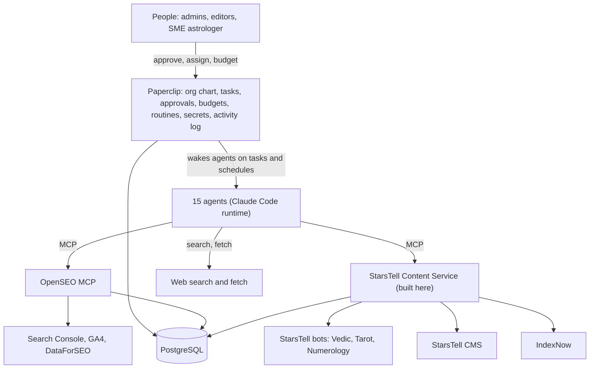
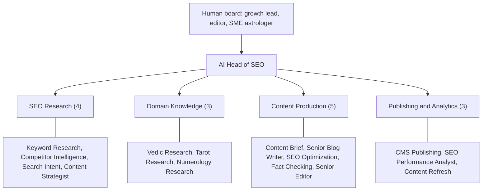
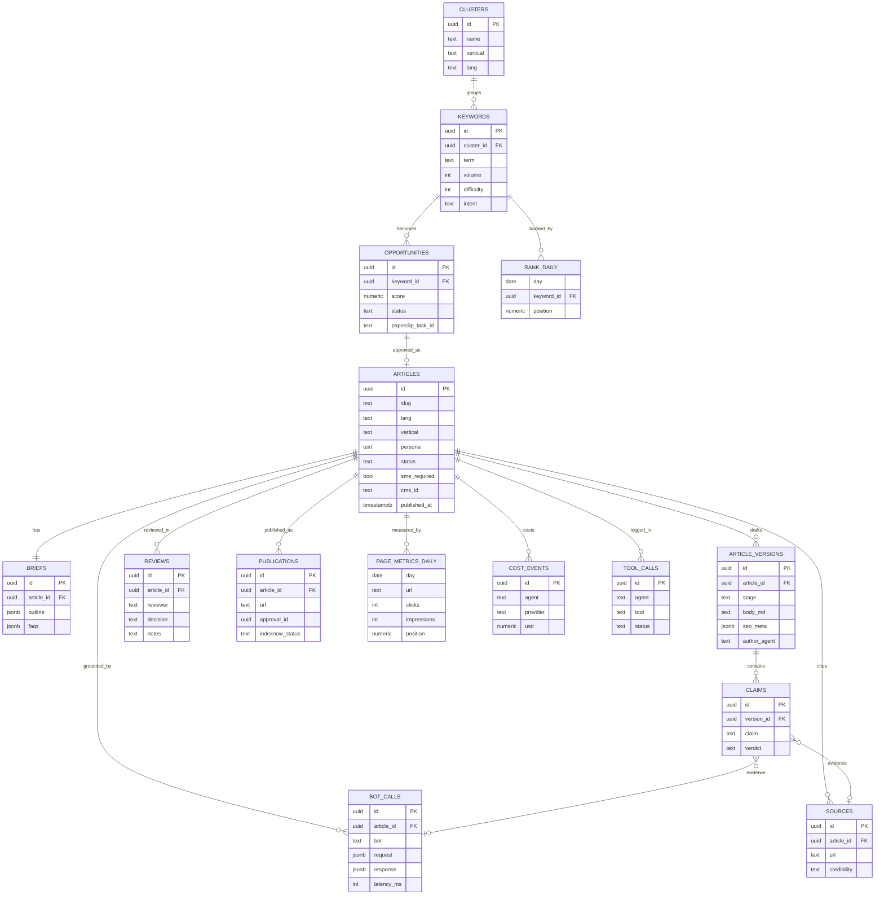

# StarsTell SEO Department: Architecture Proposal

Prepared 19/11/2026. Status: **awaiting approval**. Numbers use the International system; ₹ at an assumed ₹88 per US$1.

Labels used below:
- **[Verified]** read in the repository's README or source on 19/11/2026
- **[Assumption]** likely, not yet confirmed
- **[Proposed]** something this project would build

---

## 1. Repository audit

| Repo | Maintenance | License | Verified capabilities | Overlap and risk | Decision |
|---|---|---|---|---|---|
| **Paperclip** `paperclipai/paperclip` | 114,896 stars, commits daily, v2026.1117.0 on 18/11/2026, 6,924 open issues | MIT | Org chart with roles and reporting lines; tasks with atomic checkout; review and approval stages; budgets per company, agent and project with hard stops; routines on cron, webhook or API; encrypted secrets; durable activity log; MCP and app connections with Allowed / Ask first / Off; Claude Code, Codex, CLI and HTTP agents; plugins with UI contributions; own Postgres in production; Node 24.11+ | Very fast release pace, so pin a version. Budget stops use reported spend, so an in-flight run can overshoot slightly | **Use** as the management layer |
| **OpenSEO** `every-app/open-seo` | 28,283 stars, commits daily, v0.1.30 on 18/11/2026 | MIT | Keyword research, rank tracking, competitor insights, backlinks, site audits, AI visibility. MCP tools in source include `get_serp_results`, `get_suggested_keywords`, `get_domain_overview`, `get_domain_keyword_suggestions`, `get_backlinks_profile`, `get_rank_history`, Search Console and GA4 tools. Docker self-host with password accounts | Needs a DataForSEO key (pay per call). Pre-1.0, tool names may change. [Assumption] can run on Postgres (a LOCAL_POSTGRES doc exists) | **Use** for SEO research |
| **CrawlSEO** `crawlseo/crawlseo` | 712 stars, v0.3.6 on 02/11/2026, small team | MIT | Search Console sync, crawler up to 2,000 pages, Core Web Vitals, striking-distance, low-CTR, content-decay and cannibalization reports, webhook and email alerts, read-only MCP. Next.js, Prisma, Postgres | Keyword, backlink and GSC features repeat OpenSEO. Decay and cannibalization reports are its real value | **Phase 4**, only if needed |
| **n8n** `n8n-io/n8n` | 211,294 stars, n8n@2.48.6 on 19/11/2026 | Sustainable Use License: internal business use allowed, no reselling or hosting for others; `.ee` files need a paid licence | 400+ integrations, webhooks, schedules, AI nodes | Paperclip routines and webhooks already cover scheduling. A second orchestrator means two audit trails | **Not needed** now |

**Why this is the smallest effective stack:** Paperclip already covers tasks, approvals, budgets, scheduling and audit. OpenSEO already covers SEO data. The only missing piece is a safe connection to StarsTell's bots and CMS, so that is the one service this repo builds.

---

## 2. Architecture

Agents never hold a key. They call MCP tools, and the tool servers hold the keys.

- **Paperclip [Verified]:** each article is a Paperclip task moving through stages. Approval gates, budgets and the activity log come from Paperclip.
- **Content Service [Proposed]:** TypeScript, one container. MCP tools for agents plus a small web app for editors. The only component that holds bot keys and CMS credentials.
- **Hosting [Assumption]:** one VM in India (4 vCPU, 16 GB) running all four in Docker. Managed Postgres optional.

---

## 3. AI organisation

---

## 4. Agent responsibility matrix

See [agents/roster.md](../agents/roster.md).

---

## 5. Content workflow

Statuses: Research → Brief → Writing → Fact Checking → SEO Review → Editorial Review → **Human Approval** → Published → Performance Monitoring.

| # | Step | Owner |
|---|---|---|
| 1 | Find the opportunity: keyword, volume, difficulty, intent | Keyword Research |
| 2 | Study the top 10 ranking pages and find the gap | Competitor Intelligence |
| 3 | Accept or drop against the monthly plan | Head of SEO |
| 4 | Write the brief and name the target persona | Content Strategist + Content Brief |
| 5 | Call the right StarsTell bot; store request and response | Domain agent |
| 6 | Collect external references with URLs and access dates | Fact Checking |
| 7 | Write the first draft from brief, bot answers and sources only | Senior Blog Writer |
| 8 | Split the draft into claims and give each a verdict | Fact Checking |
| 9 | Meta, headings, internal links, schema, alt text | SEO Optimization |
| 10 | Readability, repetition, brand voice, originality | Senior Editor |
| 11 | **Human approval:** approve, reject, request revisions or edit. SME sign-off for festival, panchang, muhurat and remedy content | People |
| 12 | Publish, add metadata and schema, ping sitemap and IndexNow | CMS Publishing |
| 13 | Track impressions, clicks, CTR, position, conversions | Performance Analyst |
| 14 | Flag decaying or outdated posts and open refresh tasks | Content Refresh |

**Loops and safeguards**
- **Fact-check loop:** an unsupported or contradicted claim sends the draft back with the claim list. After 2 failed rounds, escalate to the Head of SEO and a person.
- **Editorial loop:** rubric score below the bar returns the draft to the writer, or to the brief if the angle is wrong. Maximum 3 rounds, then escalate.
- **Retries:** timeouts and 5xx retry with backoff (3 tries). Errors that waiting cannot fix fail at once with the reason on the task.
- **Audit log:** Paperclip records task changes, runs, costs and approvals. The Content Service records every tool call, bot response and version.

**Brand rules every draft is checked against:** name the astrological mechanism; tie outcomes to the reader's own effort; never guarantee a result; never use fear to sell; never use "predict", "destiny" or "fate"; no specific tithi, muhurat or festival date goes live without SME sign-off.

---

## 6. API integration design

**Adapter contract [Proposed]**
- Every bot sits behind the same small interface in the Content Service.
- Endpoints, parameters and response fields are copied from StarsTell's docs, never guessed.
- Each response is validated against a schema; a mismatch fails loudly.

**Logging:** request, response, latency, status and cost per call, linked to the article and the claim that used it.

**Limits and failures:** documented rate limits become a queue; responses are cached per question; if a bot is down the task pauses with a clear reason.

| Tool name (placeholder) | Wraps | Status |
|---|---|---|
| `vedic_ask`, `vedic_validate` | Vedic Astrology bot | Waiting for docs |
| `tarot_ask`, `tarot_validate` | Tarot bot | Waiting for docs |
| `numerology_ask`, `numerology_calculate` | Numerology bot | Waiting for docs |
| `cms_create_draft`, `cms_publish` | StarsTell CMS | Waiting for CMS details |

Search Console and GA4 connect through OpenSEO's Google connection. IndexNow is one call after each publish.

---

## 7. Database schema

The Content Service's own database. Paperclip and OpenSEO keep their own databases on the same Postgres instance.

---

## 8. Dashboard

Tabs: Overview, Organisation, Content, SEO, Costs, Approvals. Every tile opens the tasks behind it. The wireframe with example figures is in [proposal/index.html](proposal/index.html#dashboard).

| View | Metrics | Source |
|---|---|---|
| Organisation | Total agents, active agents, completed and failed tasks, pending approvals, execution cost | Paperclip API |
| Content | Researched, written, approved, published, pending review | Content Service |
| SEO | Impressions, clicks, CTR, average position, top and declining keywords, organic conversions | OpenSEO (GSC, GA4) |
| Financial | API cost, LLM cost, cost per article, cost per published article, spend per agent | Paperclip + Content Service cost ledger |
| Approvals | Queue with approve, reject, request revisions, edit draft, view sources, view agent history | Content Service editor app |

---

## 9. Security

- **Secrets:** bot, CMS, DataForSEO and Anthropic keys in Paperclip secrets or server environment variables. Never in the browser, a prompt or chat. Google access via an OAuth or service account added to Search Console.
- **Permissions:** each agent gets only its own tools. `cms_publish` rejects any call without a recorded human approval id. Paperclip connection actions set to "Ask first" for anything that changes the live site.
- **Network:** Paperclip in authenticated mode on a private network or behind SSO. OpenSEO with password accounts or Cloudflare Access. Postgres not exposed; nightly backups.
- **Budgets and misuse:** monthly budget per agent and company with hard stops. Competitor pages and web results are untrusted text, never instructions. No customer data from the bots enters articles or logs.

---

## 10. Cost estimate

LLM list prices per million tokens (input / output): Opus 5.5 $4 / $20, Sonnet 5.5 $2 / $10, Haiku 5.5 $0.10 / $0.50. Token counts are estimates, to be replaced with measured numbers after the first 10 articles.

| Per article | Model | Est. tokens in / out | US$ |
|---|---|---:|---:|
| Research: keywords, competitors, intent | Sonnet 5.5 | 150K / 10K | 0.40 |
| Strategy and brief | Opus 5.5 + Sonnet 5.5 | 80K / 8K | 0.40 |
| Domain bot calls | Sonnet 5.5 | 30K / 4K | 0.10 |
| Writing, with one revision | Opus 5.5 | 120K / 18K | 0.84 |
| Fact check incl. ~10 web searches | Opus 5.5 | 100K / 8K | 0.66 |
| SEO optimization | Sonnet 5.5 | 40K / 5K | 0.13 |
| Senior edit | Opus 5.5 | 40K / 6K | 0.28 |
| Publishing | Haiku 5.5 | 20K / 2K | 0.01 |
| DataForSEO via OpenSEO [Assumption] | n/a | n/a | 0.20 to 0.60 |
| **Total per article** | | | **3.0 to 3.5** |
| With rejected drafts (about 1 in 3) | | | **~4.6 per published** |

| Monthly, at 40 published articles | US$ | ₹ |
|---|---:|---:|
| Article pipeline | 185 | 16,300 |
| Head of SEO, analyst and refresh routines | 40 | 3,500 |
| Rank tracking and monthly research [Assumption] | 30 to 60 | 2,600 to 5,300 |
| VM in India plus backups [Assumption] | 50 to 80 | 4,400 to 7,000 |
| Paperclip, OpenSEO, CrawlSEO licences | 0 | 0 |
| **Total** | **305 to 365** | **26,800 to 32,100** |

Not included: calls to StarsTell's own bot APIs, CMS hosting, and review time. A Paperclip budget hard stop (for example $400 a month) caps the downside.

---

## 11. Roadmap

| Weeks | Phase | Scope | Done when |
|---|---|---|---|
| 0 to 1 | Discovery | Answers to section 12, API docs reviewed, CMS and Search Console access | Every integration is documented |
| 1 to 2 | Foundation | VM, Postgres, Paperclip, OpenSEO, Content Service skeleton, CMS drafts only | An agent can save a CMS draft |
| 2 to 4 | First pipeline | 3 bot adapters; research, brief, write, fact check; 5 articles end to end | 5 drafts reach human approval |
| 5 to 7 | Publish and measure | SEO agent, editor, publish gate, schema, sitemap, IndexNow, dashboard v1 | Approved posts go live in one click |
| 8 to 10 | Grow | Analyst and refresh agents, AI visibility, Hindi and Hinglish, CrawlSEO decision | Weekly report runs on its own |

---

## 12. Questions requiring input

See [questions.md](questions.md).
