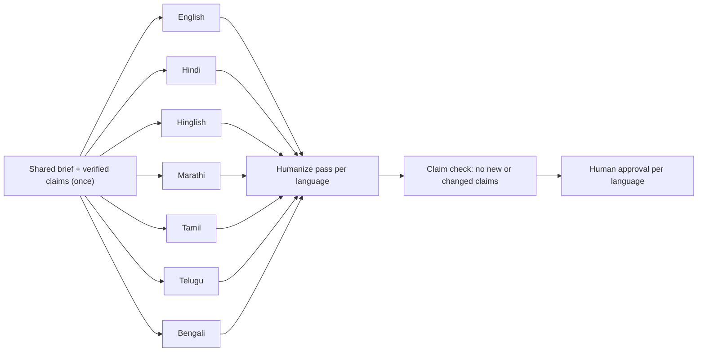

# Multilingual publishing

Every blog goes out in **7 languages, so 7 links**. Each version is written natively for its readers from one shared brief and one shared set of verified facts. Versions are never machine-translated word for word.

## 1. Languages and URLs

| Language | Code (hreflang) | URL pattern | Script |
|---|---|---|---|
| English | `en` | `/blog/sade-sati-remedies` | Latin |
| Hindi | `hi` | `/hi/blog/sade-sati-ke-upay` | Devanagari |
| Hinglish | `hi-Latn` | `/hinglish/blog/sade-sati-ke-upay` | Latin (Romanised Hindi) |
| Marathi | `mr` | `/mr/blog/sade-sati-upay` | Devanagari |
| Tamil | `ta` | `/ta/blog/sade-sati-pariharam` | Tamil |
| Telugu | `te` | `/te/blog/sade-sati-pariharalu` | Telugu |
| Bengali | `bn` | `/bn/blog/sade-sati-pratikar` | Bengali |

Slugs above are illustrative; each comes from that language's own keyword research.

Rules:
- **Slugs are Romanised in every language.** Native-script slugs become long percent-encoded links (`%E0%A4%B8...`) when shared on WhatsApp. The page title, headings and body stay in the native script.
- **Every version lists all live versions with hreflang**, plus `x-default` pointing to English. A version is added to the hreflang set only once it is live, so no link points to a missing page.
- **Each version has its own meta title, description, alt text and FAQ**, written in that language, not translated.
- **The language list is configuration**, not code. Adding or dropping a language is one setting.

## 2. How one blog becomes 7

1. **Shared once:** research, competitor study, brief, StarsTell bot answers, fact check. Facts are checked once, in a language-neutral claims list.
2. **Keywords per language:** each language gets its own keyword research. People search "sade sati ke upay" in Hindi and Hinglish, not a translation of "sade sati remedies". [Assumption] DataForSEO covers Hindi well; coverage for Marathi, Tamil, Telugu and Bengali will be checked in Phase 1, with Google autocomplete and Search Console as fallback.
3. **Written natively per language:** one Language Writer per language writes from the brief and the verified claims, using local terms, examples and festival context (for example Durga Puja context in Bengali, Pongal in Tamil).
4. **Humanize pass per language:** see [humanizing.md](humanizing.md).
5. **Claim check per language:** the Fact Checking agent confirms each version says only what the verified claims say. Nothing is added, dropped in meaning or softened into a guarantee.
6. **Human approval per language:** a native-speaker reviewer approves each version. Festival, panchang, muhurat and remedy content still needs SME sign-off.

## 3. Publishing

- Versions publish as they are approved; a slow Tamil review does not hold back the English post.
- Each version goes into its own language sitemap under one sitemap index, and IndexNow is pinged per URL.
- Internal links point to pages in the same language.

## 4. Review workload

At 40 blogs a month this is **280 pages a month to approve**. Reviewers are needed per language (see [questions.md](questions.md)). Options to discuss once quality is proven: full review for English and Hindi, and a sample review (for example 1 in 3) for the others.
