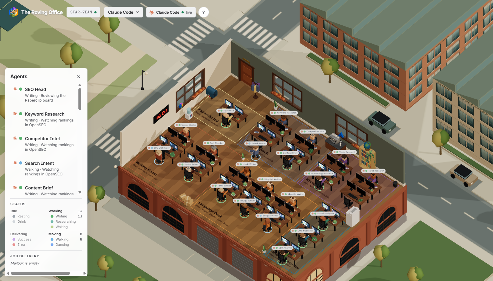

# StarsTell agent office

A live 3D office with one desk area per department. Every StarsTell agent sits at its own desk in its own department all day and works there. An agent only gets up to **walk to another department to coordinate** (a handover or a question), to fetch knowledge from the StarsTell bots shelf, or to send finished work out.



Built on [The Roving Office](https://github.com/atlassian-labs/roving-office) by Atlassian Labs (Apache-2.0), included as a git submodule pinned to commit `f3c51c8`, plus a small StarsTell patch.

## Run it

Needs Node 18 or newer.

```bash
git submodule update --init
```

```bash
node visualizer/starstell-office.mjs
```

Then open http://127.0.0.1:8090/office/STAR-7EAM. Faster: `SPEED=2 node visualizer/starstell-office.mjs`. Stop with Ctrl+C.

The script applies the patch, starts the office, loads the department layout, and plays the pipeline for 6 example blogs. Starting the office writes its local address and write token to `~/.roving-office/endpoint.json`; that is how The Roving Office works on any machine.

## The departments

| Floor area | Who sits there | What happens there |
|---|---|---|
| **Paperclip HQ** (by the door) | SEO Head | Plans, assigns tasks, takes approvals |
| **SEO Research** | Keyword Research, Competitor Intel, Search Intent, Content Brief | OpenSEO work, on their own screens |
| **Knowledge** | Vedic, Tarot, Numerology Research | Ask the StarsTell bots (the bookshelf here) |
| **Writing Room** | Senior Writer, Fact Checker, SEO Optimizer, Senior Editor | Draft, fact check, SEO, final edit |
| **Language Desk** | Hindi, Hinglish, Marathi, Tamil, Telugu, Bengali Writers | 6 native versions |
| **Design · Publish · Results** | Visual Designer, CMS Publisher, SEO Analyst | Images, publishing (printer), Search Console |

## Who walks where, and why

| Walk | Reason |
|---|---|
| SEO Head → Keyword Research | Assigns a new task |
| Content Brief → Knowledge | Brief ready, needs the bot answers |
| Knowledge → Senior Writer | Bot answers logged |
| Senior Writer → Knowledge | Only when a claim fails the fact check |
| Fact Checker → Language Desk | Claims verified, start the 6 languages |
| SEO Optimizer → Visual Designer | Needs alt text in 7 languages |
| Senior Editor → SEO Head | Ready for human approval (status: waiting on you) |
| SEO Head → CMS Publisher | Approved, publish the 7 links |
| SEO Analyst → SEO Head | First results are in |

Between tasks every agent stays seated, doing desk work for their department. The desk label shows the current task, for example `ST-142 · Fact check every claim`. Click a character for its current tool. Press `?` in the office for controls.

## What the patch changes

[patches/starstell-departments.patch](patches/starstell-departments.patch), applied to the submodule by the start script:

- `src/starstell/departments.js`: the 6 departments, their desks, and the coloured floor areas with labels
- `src/agents/AgentManager.js`: seat an agent at a free desk in its own department; a new `visit` walk to a colleague's desk and back
- `src/data/aop-reducer.js`: read `ext.department` from AOP events; turn a `Coordinate` tool call into a visit
- `src/config.js`: room widened from 26 x 20 to 36 x 26 to fit 22 desks
- `src/world.js`: draw the department floors

The desk layout is [starstell-layout.json](starstell-layout.json).

## What it shows today, and later

- **Today:** a simulation of the pipeline, sent as the same Agent Office Protocol events a real Claude Code agent sends.
- **Later:** Paperclip's agents run on Claude Code, and The Roving Office ships a Claude Code adapter. Once Phase 1 runs, real agents can appear here, each tagged with its department.

## Step-by-step example with outputs

[walkthrough.html](walkthrough.html) walks one blog through all 17 steps and shows what each step produces, plus the published page in 7 languages. All its data is illustrative.
